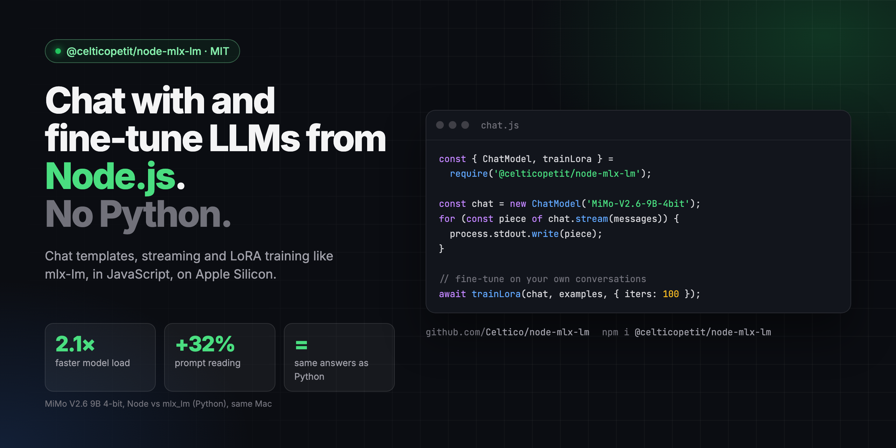

# @celticopetit/node-mlx-lm



**Website:** https://celtico.github.io/node-mlx-lm/

Chat with and fine-tune MLX language models from Node.js — no Python.

The JavaScript side of [mlx-lm](https://github.com/ml-explore/mlx-lm), on top of the native engine [@celticopetit/mlx-node](https://github.com/Celtico/mlx-node):

- **Chat**: the model's tokenizer (`@huggingface/tokenizers`) and chat template (`@huggingface/jinja`), with streaming text. Greedy output is token-for-token identical to `mlx_lm`.
- **Prompt cache**: the next message of a conversation only reads what is new.
- **LoRA training** with the same data handling, loss, optimizer and adapter files as `mlx_lm lora`. The adapters load in both.

Supports **Qwen 3.5** models in mlx-community format (for example MiMo V2.6 9B, 4-bit) on **Apple Silicon Macs**. Linux (CUDA) and Windows are planned, as new engines under the same API.

## Install

```sh
npm install @celticopetit/node-mlx-lm
```

This installs `@celticopetit/mlx-node`, which downloads its prebuilt engine and MLX. Nothing is compiled.

## Chat

```js
const { ChatModel } = require('@celticopetit/node-mlx-lm');

const chat = new ChatModel('/path/to/mlx-community/model');
for (const piece of chat.stream([{ role: 'user', content: 'Write a JavaScript function that adds two numbers.' }], { maxTokens: 200 })) {
  process.stdout.write(piece);
}
chat.model.close(); // frees the model's memory
```

Options: `maxTokens`, `temperature` (0 is greedy), `topP`, `topK`.

## LoRA

Examples are conversations in the `mlx_lm` chat format, one per line of a `.jsonl` file: `{"messages": [{"role": "user", "content": "…"}, {"role": "assistant", "content": "…"}]}`.

```js
const fs = require('node:fs');
const { ChatModel, trainLora } = require('@celticopetit/node-mlx-lm');

const chat = new ChatModel('/path/to/model');
const examples = fs.readFileSync('train.jsonl', 'utf8').split('\n').filter(Boolean).map((line) => JSON.parse(line));
await trainLora(chat, examples, {
  adapterPath: '/tmp/adapters', iters: 100, learningRate: 1e-5, numLayers: 8,
  maskPrompt: true, gradCheckpoint: true, deltaChunk: 64, onReport: (report) => console.log(report),
});

chat.model.loadAdapters('/tmp/adapters'); // or adapters made by `mlx_lm lora`
```

Long examples on a small Mac: with `gradCheckpoint: true` the loss is computed in chunks of 256 positions, and for Qwen 3.5 models (Gated DeltaNet layers) `deltaChunk: 64` computes the recurrence in chunkwise form, which keeps one state per chunk instead of one per token. With MiMo 9B on a 16 GB Mac that is the difference between 512 tokens not fitting and 1,536 training in 11.1 GB (2,048 in one step, 12.2 GB).

Calls are synchronous and use the GPU: run the model in its own process (a `child_process` or an Electron `utilityProcess`) so your UI never waits on it.

## Tests

They compare with `mlx_lm` on a tiny random model (Python with `mlx-lm`, only for the references):

```sh
python test/make_tiny.py /tmp/tiny
python test/make_lora_ref.py /tmp/tiny
TINY_MODEL=/tmp/tiny npm test
```

## Licence

MIT. It follows [mlx-lm](https://github.com/ml-explore/mlx-lm) (MIT, Apple Inc.); see `NOTICE`.
